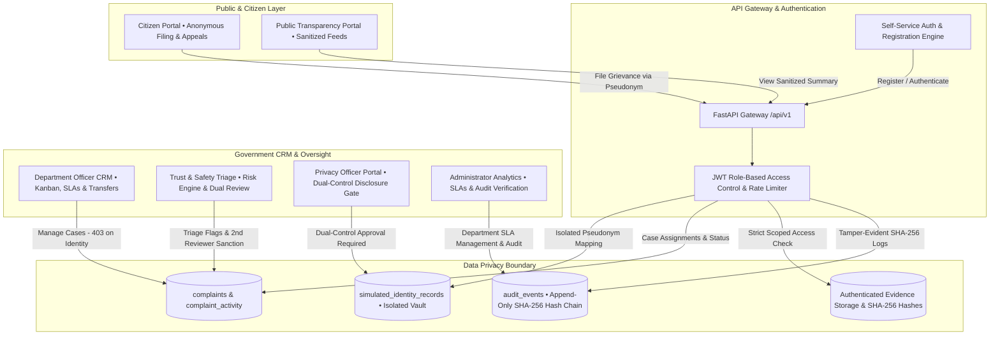

# CivicTrust • Privacy-Preserving Citizen Grievance CRM

CivicTrust is a production-grade, full-stack Citizen Relationship Management (CiRM) platform engineered with mathematical privacy boundaries, department SLA management, dual-control abuse adjudication, and append-only cryptographic audit logging.

---

## 1. System Architecture



---

## 2. Technology Stack

- **Frontend**: React 19, TypeScript, Vite, Tailwind CSS, Lucide React, Recharts, Axios.
- **Backend**: Python FastAPI, Pydantic v2, PyJWT, bcrypt, uvicorn.
- **Database & ORM**: SQLAlchemy 2.0 with Alembic migrations, PostgreSQL 16 (or zero-setup SQLite fallback).
- **Security & Integrity**: Append-only cryptographic SHA-256 tamper-evident hash chaining, strict role-based access control (RBAC), sliding-window auth rate limiting.
- **Containerization**: Docker Compose (`db`, `backend`, `frontend`).

---

## 3. User Roles & Authentication

CivicTrust provides self-service user registration and secure authentication via the glassmorphism **Sign In & Register Modal** located in the top navigation bar.

### User Roles Matrix

| Role | Core Capabilities | System Permissions & Restrictions |
| :--- | :--- | :--- |
| **Citizen** | Lodge grievances anonymously, upload private evidence, view tracking status, engage in 2-way anonymous clarification, file formal appeals. | Receives randomized pseudonymous ID (`CITIZEN-XXXXXXXX`). Isolated from other citizens' complaints (`403 Forbidden`). |
| **Department Officer** | Case triage, priority assignment, internal investigation notes, SLA tracking, cross-department case transfers, formal resolution. | Scoped to assigned government department. **Strictly barred from citizen identity vault (`403 Forbidden`)**. |
| **Trust & Safety Reviewer** | Review community abuse flags, deterministic risk signal evaluation, forensic evidence examination, initial sanction recommendation, disclosure petition submission. | Cannot self-approve serious sanctions without independent 2nd reviewer. Cannot approve own disclosure petitions. |
| **Privacy Officer** | Independent data protection oversight, dual-control adjudication of identity disclosure petitions, inspection of privacy audit trail. | Enforces statutory necessity standards. Separate from frontline administrators and case reviewers. |
| **Administrator** | System-wide CRM analytics, department SLA policy configuration, disclosure petition review, cryptographic hash chain integrity verification. | Full operational visibility. Cannot bypass dual-control checks or decrypt identities without approved petitions. |
| **Public Visitor** | View sanitized transparency registry, browse verified resolutions, inspect anonymized complaint progress timelines. | Completely unauthenticated. Receives zero private evidence, citizen contact info, or internal notes. |

### Pre-Seeded Reference Credentials (For Evaluation & Testing)

To facilitate immediate workflow testing, the database includes pre-configured reference accounts (Default password for all pre-seeded accounts: `Pass1234!`):

| Role | Username | Email | Department / Specialization |
| :--- | :--- | :--- | :--- |
| Citizen | `priya_citizen` | `priya.citizen@civictrust.gov` | Verified Citizen (`CITIZEN-8A4F102B`) |
| Citizen | `rahul_citizen` | `rahul.citizen@civictrust.gov` | Citizen with Due-Process Appeal Record |
| Citizen | `tanya_citizen` | `tanya.citizen@civictrust.gov` | Citizen Profile |
| Department Officer | `officer_sharma` | `sharma.pwd@civictrust.gov` | Public Works Department (PWD) |
| Department Officer | `officer_anita` | `anita.water@civictrust.gov` | Water Supply & Sewerage Board (WATER) |
| Trust & Safety Reviewer | `reviewer_chen` | `chen.trust@civictrust.gov` | Lead Reviewer (Triage & Decisions) |
| Trust & Safety Reviewer | `reviewer_malik` | `malik.trust@civictrust.gov` | Secondary Reviewer (Dual-Control Sanctions) |
| Privacy Officer | `privacy_officer_verma` | `verma.privacy@civictrust.gov` | Data Protection Officer (Disclosure Gate) |
| Administrator | `admin_gupta` | `gupta.admin@civictrust.gov` | Executive Operations & SLA Management |

> **Self-Service Registration:** You can register new accounts at any time using the **Register** tab in the top navigation bar. For Department Officers, select your assigned municipal agency during registration.

---

## 4. Academic Demonstration Scenarios (Scenarios A through H)

CivicTrust includes 8 end-to-end scenarios executed directly across live role dashboards:

### Scenario A: Legitimate Grievance Lifecycle
- **Focus:** Complete lifecycle from submission to resolution.
- **Workflow:**
  1. Sign in as Citizen (`priya_citizen`) or register a new citizen account.
  2. Lodge a grievance under Public Works Department (PWD), attach evidence, and view case `CT-2026-1001`.
  3. Sign in as Officer (`officer_sharma`), open PWD Case Inbox, inspect evidence, add internal notes, and click **Resolve Case**.
  4. Citizen receives an automated in-app notification confirming verified resolution.

### Scenario B: Insufficient Evidence != Malicious Fabrication
- **Focus:** Protecting ordinary citizens who lack specialized forensic equipment.
- **Workflow:**
  1. Citizen reports discolored municipal water (`CT-2026-2002`). A community flag triggers triage.
  2. Sign in as Trust & Safety Reviewer (`reviewer_chen`).
  3. Open Case `CT-2026-2002`. Note that ordinary residents lack water laboratory test kits.
  4. Dismiss the abuse flag with finding `INSUFFICIENT_EVIDENCE`. Citizen's account is preserved with zero sanctions.

### Scenario C: Dual-Reviewer Abuse Sanction
- **Focus:** Preventing arbitrary or single-operator punishment.
- **Workflow:**
  1. Case `CT-2026-3003` contains verified forged contractor invoice graphics.
  2. Sign in as Lead Reviewer (`reviewer_chen`). Record finding `SUBSTANTIATED_ABUSE` and recommend `TEMPORARY_RESTRICTION`.
  3. Note that Reviewer Chen cannot approve their own recommendation (dual-control violation).
  4. Sign in as Secondary Reviewer (`reviewer_malik`) to conduct independent review and approve the sanction.

### Scenario D: Citizen Due-Process Appeal Upheld
- **Focus:** Rectifying flawed determinations through factual corroboration.
- **Workflow:**
  1. Citizen (`rahul_citizen`) appeals sanction on Case `CT-2026-4004` (alleged false dispatch report).
  2. Citizen provides official municipal telephone log timestamps.
  3. Sign in as Reviewer (`reviewer_malik`). Inspect appeal evidence, corroborate dispatch logs, and click **Uphold Appeal**.
  4. Active sanction is automatically revoked and citizen access restored.

### Scenario E: Unjustified Disclosure Petition REJECTED
- **Focus:** Preventing administrative overreach and protecting citizen privacy.
- **Workflow:**
  1. Reviewer petitions to unmask citizen identity for Case `CT-2026-5005` (bus route delay) to inspect transit passes.
  2. Sign in as Privacy Officer (`privacy_officer_verma`) or Administrator (`admin_gupta`).
  3. Open **Privacy Disclosure Panel**. Review petition justification.
  4. Reject petition under statutory proportionality rules. Server returns 403 on identity queries; complainant identity remains fully sealed.

### Scenario F: Controlled Identity Disclosure APPROVED & Audited
- **Focus:** Lawful identity disclosure under verified criminal extortion or deepfake fraud.
- **Workflow:**
  1. Case `CT-2026-6006` involves verified synthetic extortion threats against civic staff.
  2. Lead Reviewer submits disclosure petition with formal statutory police reference.
  3. Sign in as Privacy Officer (`privacy_officer_verma`). Inspect statutory grounds and approve petition.
  4. Approved disclosure enables authorized decryption; the access event is recorded in the append-only cryptographic audit ledger.

### Scenario G: Officer Barred from Identity Mapping (Strict 403)
- **Focus:** Architectural separation of power between grievance remediation and personal identity.
- **Workflow:**
  1. Sign in as Department Officer (`officer_sharma`).
  2. Navigate to Officer Workspace. Attempt to query identity disclosure records.
  3. The server immediately rejects the request with HTTP `403 Forbidden: Department Officers are barred from accessing citizen identity records`.

### Scenario H: Coordinated Brigade Flagging Defense
- **Focus:** Preventing targeted silencing of civic whistleblowers.
- **Workflow:**
  1. Case `CT-2026-8008` (public park encroachment) is targeted by an organized syndicate with 4 rapid flags in 8 minutes.
  2. Sign in as Reviewer (`reviewer_chen`).
  3. Open investigation for `CT-2026-8008`.
  4. Inspect the Risk Engine breakdown: The system identifies the velocity anomaly (`COORDINATED_FLAGGING_CAMPAIGN_DETECTED`) and discounts the penalty score, keeping risk below 15.0 and preventing automated grievance removal.

---

## 5. Local Setup & Execution Guide

### Option 1: Docker Compose (Production Bundle)

```bash
# Start all services (Database, Backend API, Frontend Nginx)
docker compose up -d

# Verify services are healthy
docker compose ps
```

- **Frontend Application**: [http://localhost:3000](http://localhost:3000)
- **Backend API Documentation**: [http://localhost:8001/docs](http://localhost:8001/docs)
- **PostgreSQL Database**: Port 5433 (mapped to 5432 internally)

To rebuild frontend or backend after code changes:
```bash
docker compose build frontend
docker compose up -d frontend
```

### Option 2: Standalone Local Development

1. **Backend Setup**:
   ```powershell
   cd backend
   python -m venv venv
   .\venv\Scripts\activate
   pip install -r requirements.txt email-validator
   uvicorn app.main:app --reload --port 8000
   ```

2. **Frontend Setup**:
   ```powershell
   cd frontend
   npm install
   npm run dev
   ```
   *Frontend dev server runs at [http://localhost:5173](http://localhost:5173).*

---

## 6. Automated Test Suite (19/19 Passing)

The test suite validates role isolation, security boundaries, CRM workflows, and cryptographic integrity:

```powershell
# Run inside Docker container
docker exec civictrust_backend pytest app/tests/ -v

# Or run locally in backend venv
cd backend
pytest app/tests/ -v
```

### Test Suite Structure
1. `app/tests/test_civictrust.py` (7 tests):
   - `test_auth_and_roles`: Validates JWT token issuance and role claims for all personas.
   - `test_public_transparency_privacy_boundary`: Verifies public endpoints strip names, emails, and internal notes.
   - `test_officer_denied_identity_access_scenario_g`: Verifies officers receive 403 on identity queries.
   - `test_coordinated_flagging_defense_scenario_h`: Verifies brigade defense suppresses synthetic penalty spikes.
   - `test_complaint_rejection_without_identity_exposure_or_sanction`: Verifies administrative rejection does not sanction citizens.
   - `test_tamper_evident_audit_chain_integrity`: Verifies cryptographic SHA-256 hash chaining from genesis event.
   - `test_dual_reviewer_sanction_flow_scenario_c`: Verifies dual-reviewer requirement and blocks self-approval.

2. `app/tests/test_security_boundaries.py` (7 tests):
   - `test_cross_citizen_complaint_isolation`: Cross-citizen private detail query returns 403.
   - `test_citizen_cannot_perform_officer_or_admin_status_update`: Citizen status escalation returns 403.
   - `test_cross_department_officer_evidence_isolation`: Water officer downloading PWD evidence returns 403.
   - `test_unauthenticated_evidence_download_forbidden`: Anonymous evidence download returns 401.
   - `test_dual_control_disclosure_requester_self_approval_blocked`: Requester self-approval returns 403.
   - `test_privacy_officer_adjudication_and_dual_control`: Privacy Officer review and rationale enforcement.
   - `test_rejected_disclosure_request_never_leaks_identity`: Rejected disclosure returns 400 with zero identity data.

3. `app/tests/test_crm_lifecycle.py` (5 tests):
   - `test_complete_complaint_and_evidence_lifecycle`: Filing -> evidence upload -> authorized download -> 2-way messaging.
   - `test_officer_crm_workflow_and_case_transfer`: Assignment, priority justification, internal notes, cross-department transfer.
   - `test_case_resolution_and_in_app_notifications`: Case resolution triggers citizen in-app notification; read state tracking.
   - `test_password_reset_flow_and_session_invalidation`: Forgot-password token -> password update -> old password rejection -> logout audit.
   - `test_department_workload_and_sla_configuration`: Workload metrics calculation and administrative SLA updates.
